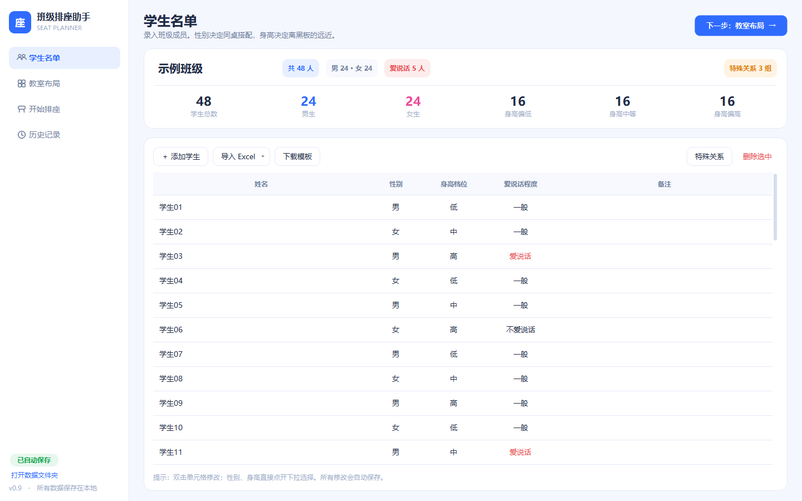
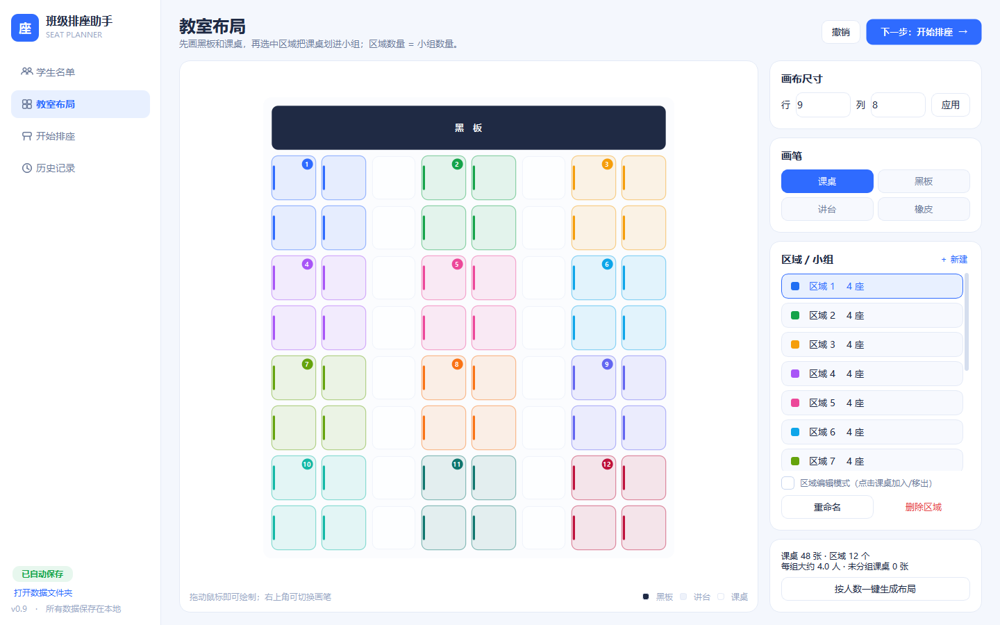
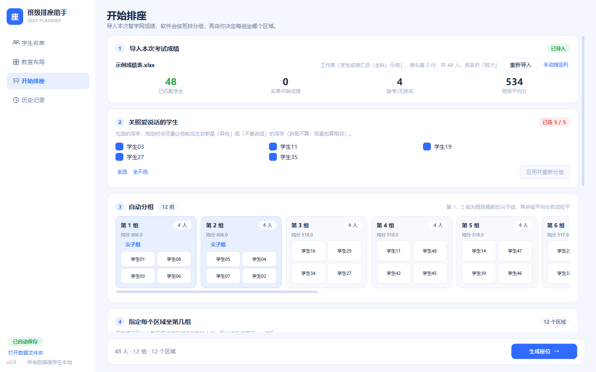
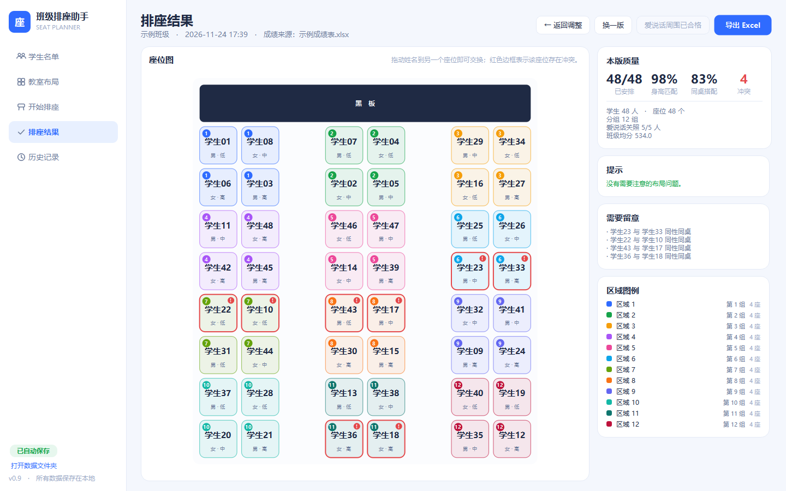

# 班级排座助手 · Classroom Seat Planner


一个面向班主任的桌面排座工具：导入智学网成绩，按班排自动分组，再综合身高、性别、特殊关系和“爱说话程度”生成座位，最后导出可直接打印的 Excel 座位表。

界面使用 **Python + PySide6（Qt6）**，现代浅色蓝主题，Windows 下可打包成单文件 exe。

> 本项目不含任何真实学生或班级数据。仓库中的姓名、成绩、截图均为虚构示例。

---

## 界面预览

| 学生名单 | 教室布局 |
| --- | --- |
|  |  |

| 排座配置 | 排座结果 |
| --- | --- |
|  |  |

---

## 功能特性

- **学生名单**：表格录入、Excel 模板导入、从智学网成绩表只导入姓名；支持备注与批量删除。
- **三档身高**：低 / 中 / 高，用于“前低后高”的前后排安排。
- **爱说话程度**：不爱说话 / 一般 / 爱说话；排座时可勾选要关照的学生，让他们前后左右尽量坐异性或“不爱说话”的同学。
- **特殊关系**：必须分开（情侣、矛盾）/ 尽量分开（好友），成对维护。
- **教室布局**：网格画布，画笔标记课桌、黑板、讲台、过道；把课桌划成“区域”，区域数量 = 小组数量。
- **成绩导入**：自动识别智学网「学生成绩汇总」工作表、表头行、姓名 / 总分 / 班次列；识别失败可手动指定列。
- **自动分组**：第 1、2 组固定为班排最前的“尖子组”，其余组按总分平均分拉平；组人数 = 区域座位数。
- **排座约束**：身高、同桌性别、特殊关系、爱说话关照四类权重可调。
- **结果微调**：拖拽换座、实时冲突提示、一键换一版、一键优化爱说话同学周围。
- **导出 Excel**：一个工作簿两个 Sheet ——「座位表」（按真实布局绘制，可打印）+「名单」（组号 / 排 / 列 / 同桌 / 成绩）。
- **历史记录**：每次生成自动存档，支持回看、批量导出、批量删除。
- **本地运行**：不联网、不上传数据，配置和导出都在本地。

---

## 快速开始

### 环境要求

- Python 3.10+
- PySide6 6.x
- openpyxl 3.1+

### 源码运行

```bash
git clone https://github.com/<your-name>/classroom-seat-planner.git
cd classroom-seat-planner
python -m pip install -r requirements.txt
python run.py
```

Windows 下也可以直接双击 `run.bat`（需要 Python 已加入 PATH）。

### 打包成 exe（Windows）

```powershell
python -m pip install -r requirements-dev.txt
powershell -ExecutionPolicy Bypass -File build_exe.ps1
```

生成的文件在 `dist/班级排座助手.exe`。

---

## 使用流程

### 1. 学生名单

- 在「学生名单」页逐个添加，或下载模板后批量导入；
- 填写姓名、性别、身高（低/中/高）、爱说话程度；
- 在「特殊关系」里成对设置“必须分开 / 尽量分开”。

### 2. 教室布局

- 用画笔画出黑板、讲台和课桌，过道留空；
- 新建区域，开启「区域编辑模式」，点击课桌把区域分好；
- 每个区域的座位数就是该组人数；也可以点「按人数一键生成布局」。

### 3. 开始排座

1. 导入智学网成绩表；
2. 勾选要关照的“爱说话”同学（默认全选）；
3. 检查自动分组；
4. 给每个区域指定一个小组；
5. 按需调整四个权重滑块；
6. 点「生成座位」。

### 4. 结果与导出

- 座位图按教室真实布局显示，颜色代表区域，红框表示冲突；
- 可拖动学生换座，或点「换一版」重新生成；
- 点「导出 Excel」得到「座位表 + 名单」两个 Sheet；
- 历史记录里可以回看和重新导出。

---

## 成绩表格式

软件针对智学网导出的 Excel 做了适配：

- 工作表名包含「汇总」优先；
- 第 1 行可以是大标题，第 2 行是表头；
- 至少包含 `姓名` 和 `总分`，有 `班次`（班排）更好；
- 缺考学生的总分 / 排名可以是「缺考，不计排名」或 `-`。

仓库自带一份完全虚构的示例：`samples/示例成绩表.xlsx`，可直接导入体验。

> 也可以导入自己的成绩表。若表头不标准，导入失败时在弹窗里选择「手动指定列」，依次指定工作表、表头行、姓名列、总分列、排名列即可。

---

## 规则说明

### 分组

1. 按班排升序；缺考 / 无排名的学生按原表顺序排在最后；
2. 第 1 组、第 2 组取头部名次（尖子组）；
3. 其余学生用「蛇形初排 + 随机交换局部搜索」分到剩余组，使各组总分平均分尽量接近；
4. 每组人数由对应区域的座位数决定；
5. “必须分开”的关系对不会进入同一组；“尽量分开”的优先拆开。

### 排座

每个区域通常 3~7 个座位，采用区域内部全排列 / 爬山法求最小代价：

- **身高**：座位到黑板的距离 vs 身高档位，前低后高；
- **性别**：左右相邻的两张桌构成“同桌”，按异性 / 同性模式扣分；
- **关系**：切比雪夫距离 ≤ 1 视为相邻，“必须分开”重罚、“尽量分开”轻罚；
- **爱说话**：被关照学生前后左右（含同桌，斜角不算）应为异性或“不爱说话”，否则扣分。

四类约束按界面权重加权，拖动换座后实时重算。

---

## 目录结构

```
classroom-seat-planner/
├─ app/
│  ├─ core/            数据模型、存储、成绩解析、分组、排座、Excel 导出
│  ├─ ui/              Qt 界面：主题、组件、画布、页面、主窗口
│  └─ main.py          程序入口
├─ assets/app.ico      程序图标
├─ docs/screenshots/   README 截图（虚构数据）
├─ samples/            虚构示例成绩表
├─ tools/              开发脚本与测试
├─ run.py              启动入口
├─ run.bat             Windows 双击启动（源码）
├─ build_exe.ps1       PyInstaller 打包脚本
├─ requirements.txt
└─ requirements-dev.txt
```

---

## 测试

在项目根目录执行（需要先安装依赖）：

```bash
python -m tools.test_core        # 分组 + 排座核心
python -m tools.test_edge        # 不等容量、无黑板、座位不足等边界
python -m tools.test_export      # Excel 导出
python -m tools.test_chatty      # 爱说话关照规则
python -m tools.test_ui          # 界面流程（离屏）
python -m tools.test_chatty_ui   # 爱说话界面流程
python -m tools.test_history_batch
python -m tools.repro_gender     # 名单编辑持久化回归
```

重新生成 README 截图：

```bash
python -m tools.make_sample
python -m tools.capture_screens
```

---

## 数据与隐私

- 所有数据保存在程序同级 `data/` 目录（便携式），不上传网络；
- `data/config.json` 保存名单、关系、布局与偏好；
- `data/history.json` 保存每次排座结果；
- 导出的 Excel 默认在 `data/导出/`；
- 仓库本身不包含 `data/`，也不包含任何真实学生信息。

---

## 已知限制

- 图形界面以 Windows + PySide6 为主要测试环境，macOS / Linux 理论可运行但未充分验证；
- “必须分开”“爱说话”等是强/弱约束的组合，极端性别比例或座位结构下可能无法 100% 满足，结果页会标红提示；
- 单文件 exe 首次启动需要解压运行库，约 3~5 秒；
- 暂不支持多班级同时管理（可通过备份 `data/` 切换）。

---

## 贡献

欢迎提 Issue 或 PR。提交前请：

1. 不要提交任何真实学生姓名、成绩或班级信息；
2. 运行 `python -m tools.test_core` 等测试确保通过；
3. 截图请使用 `tools/demo_data.py` 的虚构数据生成。

---

## License

[MIT](LICENSE)

Copyright (c) 2026 Classroom Seat Planner contributors
